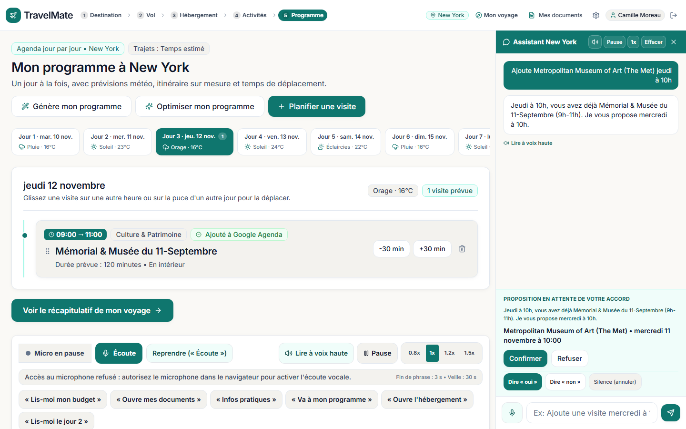
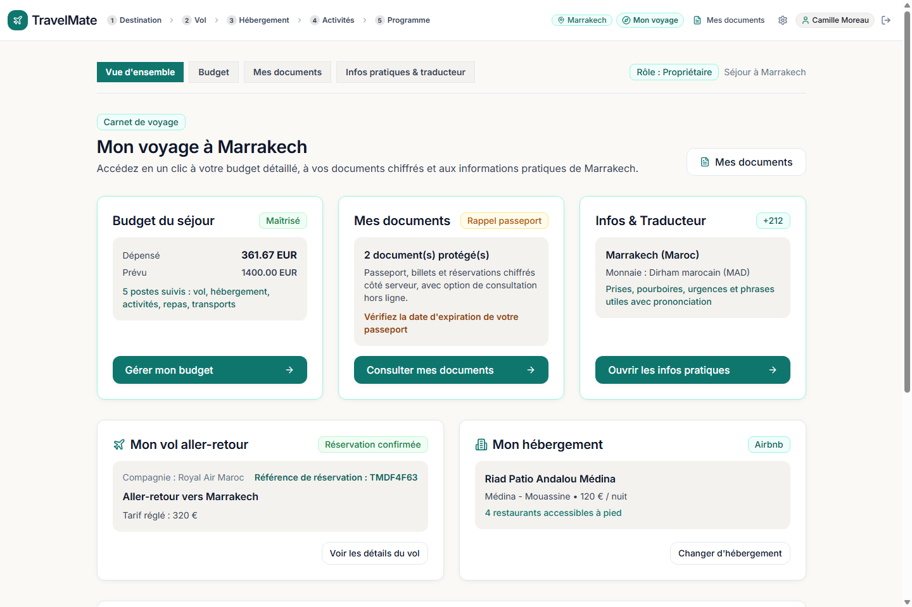
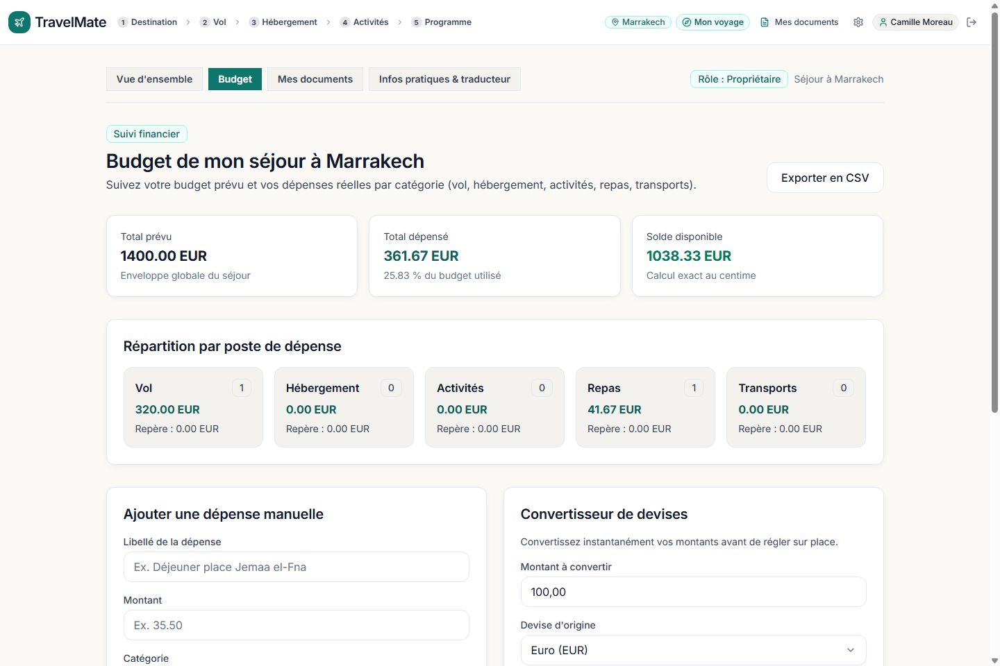
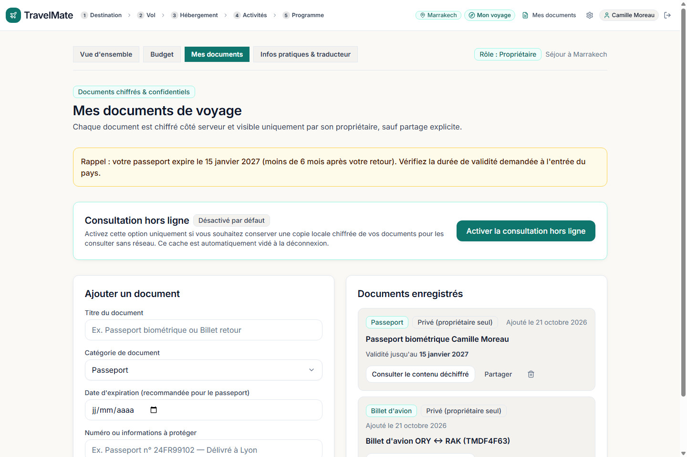

# TravelMate — Application Web Modulaire de Planification de Voyage (PWA)

**TravelMate** est une application web progressive (PWA) permettant de préparer, chiffrer et piloter un séjour de bout en bout dans n'importe quelle ville du monde : choix de la destination, vols aller-retour, hébergements sur carte interactive, sélection d'activités culturelles et gastronomiques, construction et optimisation d'un programme jour par jour tenant compte de la météo et des temps de déplacement, assistant conversationnel et vocal mains-libres en français, suivi du budget multi-devises et coffre-fort de documents chiffrés.

---

## Captures d'écran

### Programme jour par jour & Assistant IA / vocal


### Tableau de bord « Mon voyage »


### Suivi du budget & Convertisseur de devises


### Coffre-fort de documents chiffrés (AES-256-GCM)


---

## Prérequis

- **Docker** (Docker Desktop ou Docker Engine ≥ 24) avec **Docker Compose v2** (`docker compose`).
- Aucune installation locale de Python, Node.js, PostgreSQL ou Redis n'est requise sur la machine hôte : l'ensemble de la pile (PostgreSQL 16 + PostGIS, Redis 7, Backend FastAPI + Playwright, Frontend React/Vite) s'exécute dans des conteneurs isolés.

---

## Lancement

1. **Copier le fichier d'environnement d'exemple** à la racine du projet :

```bash
cp .env.example .env
```

2. **Construire et démarrer les conteneurs** :

```bash
docker compose up --build
```
*(Ajoutez `-d` pour un exécution en arrière-plan : `docker compose up --build -d`.)*

Au démarrage du conteneur `backend`, les migrations **Alembic** (`alembic upgrade head`) et le peuplement initial des 5 destinations de démonstration (`python -m app.core.seed`) sont exécutés automatiquement.

3. **Adresses d'accès** :

| Service | Adresse locale | Description |
|---|---|---|
| **Frontend (Application Web)** | `http://localhost:5173` | Interface utilisateur React 18 / TypeScript / Vite PWA |
| **Backend (API REST)** | `http://localhost:8000` | API FastAPI (`/api/v1/...`) |
| **Documentation OpenAPI / Swagger** | `http://localhost:8000/docs` | Documentation interactive des routes API |
| **Santé & état des adaptateurs** | `http://localhost:8000/health` | Statut PostgreSQL, Redis et modes (`simulated` / `real`) |

---

## Clés et variables d'environnement optionnelles

L'application fonctionne immédiatement après `cp .env.example .env` **sans aucune clé API payante**.

Vous pouvez personnaliser optionnellement dans `.env` :

- **`GEONAMES_USERNAME`** *(optionnel)* : identifiant d'un compte gratuit [GeoNames](https://www.geonames.org/login) (service web activé) pour interroger en direct l'API `searchJSON` (`featureClass=P`, villes mondiales, population, fuseau horaire). Si la variable est absente ou si le quota gratuit est atteint, l'application bascule automatiquement sur son index mondial intégré.
- **Adaptateurs hybrides optionnels (`*_PROVIDER_MODE=simulated|real`)** :
  - `WEATHER_API_KEY` (`WEATHER_PROVIDER_MODE`) : météo temps réel OpenWeatherMap.
  - `AMADEUS_CLIENT_ID` / `AMADEUS_CLIENT_SECRET` (`FLIGHTS_PROVIDER_MODE`) : recherche de vols Amadeus.
  - `GOOGLE_PLACES_API_KEY` (`PLACES_PROVIDER_MODE`) : enrichissement Google Places.
  - `OPENROUTESERVICE_API_KEY` (`ROUTING_PROVIDER_MODE`) : calcul d'itinéraires OpenRouteService.
  - `AI_API_KEY` ou `OLLAMA_BASE_URL` (`AI_PROVIDER_MODE` / `AI_CHAT_STRATEGY`) : génération et chat par modèle LLM externe ou Ollama local.

> **Sécurité** : ne commitez jamais votre fichier `.env` ni aucune clé secrète ou donnée personnelle.

---

## Ce qui est réel vs ce qui est d'exemple (indicatif)

### Données réelles
- **Villes du monde & Aéroports** :
  - Recherche mondiale de villes avec coordonnées GPS, pays (code ISO-2), population et fuseau horaire IANA (`Europe/Paris`, `Asia/Tokyo`, `America/New_York`, etc.).
  - 5 villes de démonstration pré-chargées uniquement : **Paris, Marrakech, Tokyo, New York et Rome**.
  - Rattachement automatique de chaque ville à l'aéroport commercial ou code métropolitain IATA le plus proche via les données **OurAirports** (`PAR`/`CDG`, `MIL`/`MXP`, `LON`/`LHR`, `NYC`/`JFK`, `MIR`, `LIS`, `SYD`, `LYS`, etc.).
- **Lieux d'intérêt & Galerie d'activités** :
  - Pour les villes du monde hors seed, extraction réelle depuis **Wikivoyage** (sections *Voir*, *Faire*, *Manger*), **Wikipédia** (`geosearch`) et **Wikidata** (identifiant `Q...`, coordonnées vérifiées à moins de 50 km du centre, horaires réels s'ils sont connus ou mention *« horaires non renseignés »*).
  - Attribution explicite *« Données Wikivoyage / Wikipédia (CC BY-SA 4.0) »*.
- **Photos & Crédits Wikimedia Commons** :
  - Résolution via la chaîne **Wikidata `P18` → Wikipédia `pageimages` → Wikimedia Commons `imageinfo`** (vignette ~800 px, vérification de correspondance avec l'entité Wikidata ou le nom du lieu, aucune URL d'image en double).
  - Affichage systématique du crédit **`Photo : <Auteur> — <Licence libre>`** (`CC BY`, `CC BY-SA`, `CC0`, `Domaine public`) cliquable vers la page `https://commons.wikimedia.org/wiki/File:...`.
  - Si aucune photo libre vérifiée n'est disponible, l'application n'invente jamais d'image sans rapport : elle affiche une illustration neutre par catégorie avec la mention *« Photo bientôt disponible »* ou *« Illustration »*.
- **Hébergements** :
  - **5 villes de démo (*Paris, Marrakech, Tokyo, New York, Rome*)** : vrais hôtels célèbres référencés dans **Wikidata** (`instance de = hôtel Q27686`) avec photo Wikimedia Commons vérifiée, auteur et licence libre, ou carte de type d'hébergement (*appartement*, *riad*) étiquetée **« Illustration »**.
  - **Autres villes du monde** : réutilisation de la section **« Se loger »** de Wikivoyage (nom, adresse, coordonnées, gamme *Économique / Standard / Luxe*).
  - **Repli quand Wikivoyage ne retourne rien** : aucun nom d'établissement, aucune adresse et aucune coordonnée ne sont inventés. Seules 3 cartes génériques (*« Hôtel de gamme Économique à \<ville\> »*, *« Hôtel de gamme Standard à \<ville\> »*, *« Hôtel de gamme Luxe à \<ville\> »*) sont affichées, sans marqueur précis sur la carte, étiquetées **« Illustration »**, avec les boutons de recherche directe **Booking.com** et **Airbnb**.

### Données d'exemple et prix indicatifs
- **Offres de vols d'exemple** :
  - Hors connexion à un GDS aérien commercial en temps réel, les vols proposés sur les villes du monde sont des **offres d'exemple** calculées dynamiquement selon la distance réelle entre aéroports :
    - **Direct** pour les trajets courts et moyens courriers (ex. *Paris – Lyon*, *Paris – Milan*, *Paris – Monastir*) ;
    - **Avec escale** par un hub international réel (`SIN` ou `DXB`) et durée cohérente pour les très longs courriers (> 6 000 km, ex. *Paris – Sydney*).
  - Aucun nom de compagnie aérienne ni numéro de vol ne sont inventés hors des liaisons réelles de démo : chaque carte affiche le badge **« Offre d'exemple »** et un bandeau visible **« Offres d'exemple, prix indicatifs »** en haut de l'écran.
  - Le bouton **« Voir les vrais prix »** ouvre directement **Google Flights**, **Kayak** et **Skyscanner** pré-remplis avec les codes de ville/aéroport et les dates du séjour.
  - Le bouton **« Réserver »** permet d'enregistrer l'offre d'exemple dans le séjour afin de générer le billet dans le coffre-fort, mettre à jour le budget et débloquer la galerie d'activités.
- **Prix indicatifs** :
  - Les tarifs des offres d'exemple de vols et les tarifs par nuit des hébergements sont systématiquement accompagnés du libellé **« Prix indicatif »** (modulé selon le style de voyage *Économique*, *Standard* ou *Luxe*).

---

## Lancement des tests

Les tests s'exécutent directement dans le conteneur Docker `backend` (incluant les tests unitaires, les tests d'intégration FastAPI/PostGIS/Redis et les tests E2E navigateur **Playwright**).

1. **Vérifier qu'Alembic possède une seule tête de migration** :

```bash
docker compose exec -T backend alembic heads
```

2. **Lancer la suite complète (Backend + Playwright dans Docker)** :

```bash
docker compose exec -T backend pytest -q tests /frontend/tests/test_itinerary_layout_playwright.py -rs
```

3. **Lancer uniquement les tests backend** :

```bash
docker compose exec -T backend pytest -q tests
```

---

## Structure des dossiers

```text
travelmate/
├── .env.example                 # Modèle de configuration (sans clé secrète ni donnée personnelle)
├── docker-compose.yml           # Orchestration PostgreSQL/PostGIS, Redis, Backend et Frontend
├── README.md                    # Documentation du projet
├── docs/
│   └── screenshots/             # Captures d'écran de l'application
├── backend/
│   ├── Dockerfile               # Image Python 3.12 + dépendances FastAPI & Playwright/Chromium
│   ├── alembic.ini              # Configuration des migrations de base de données
│   ├── migrations/              # Scripts de migration Alembic (versions/)
│   ├── app/
│   │   ├── main.py              # Point d'entrée FastAPI, middlewares et routeurs
│   │   ├── core/                # Config, base de données, Redis, sécurité AES-256-GCM, aéroports, seed
│   │   ├── models/              # Modèles SQLAlchemy 2.0 / GeoAlchemy2 (PostGIS)
│   │   └── modules/
│   │       ├── auth/            # Authentification JWT, profil et préférences
│   │       ├── destinations/    # Résolution des villes du monde (GeoNames) et villes populaires
│   │       ├── trips/           # Gestion des séjours, partage et contrôle d'accès (RBAC)
│   │       ├── flights/         # Recherche de vols, offres d'exemple sur distance, comparateurs & réservation
│   │       ├── accommodations/  # Hébergements Wikidata/Commons, Wikivoyage « Se loger » et repli générique
│   │       ├── places/          # Galerie de lieux (Wikivoyage/Wikipédia/Wikidata) & pipeline photos Commons
│   │       ├── itinerary/       # Programme jour par jour, moteur de validation, optimisation & Google Agenda
│   │       ├── weather/         # Prévisions météo et alertes plein air
│   │       ├── ai_chat/         # Assistant conversationnel et commandes vocales mains-libres
│   │       ├── budget/          # Suivi budgétaire au centime (`Decimal`), multi-devises et export CSV
│   │       ├── vault/           # Coffre-fort de documents chiffrés (AES-256-GCM) et rappels d'expiration
│   │       └── country_info/    # Infos pratiques par pays et traducteur de phrases utiles
│   └── tests/                   # Suite de tests unitaires et d'intégration pytest
└── frontend/
    ├── Dockerfile               # Image Node 20 / Vite dev server (port 5173)
    ├── package.json             # Dépendances React 18, TypeScript, Leaflet, Lucide
    ├── src/
    │   ├── main.tsx             # Point d'entrée React
    │   ├── EnvoiCScreens.tsx    # Écrans principaux (Destination, Vol, Hébergement, Activités, Programme, Mon voyage)
    │   └── styles.css           # Feuille de styles responsive (390 px à 1440 px)
    └── tests/
        └── test_itinerary_layout_playwright.py  # Tests E2E Playwright (mise en page, chat, voix, photos, vols & hôtels)
```

---

## Limites connues

1. **Quotas et débit des API publiques gratuites** :
   - Les appels en direct vers **Wikimedia Commons / Wikidata / Wikipédia / Wikivoyage** et **GeoNames** sont soumis aux politiques de limitation de débit publiques (HTTP 429 en cas de requêtes simultanées intensives). L'application utilise un cache Redis (`TTL` 7 jours pour les métadonnées photos), un `User-Agent` identifiable et un sémaphore de concurrence pour limiter ces appels.
2. **Couverture variable de Wikivoyage selon les villes** :
   - Certaines villes petites ou moyennes disposent de peu d'entrées structurées dans la section *« Se loger »* de Wikivoyage ; dans ce cas, TravelMate n'invente aucun établissement et affiche uniquement les 3 cartes génériques (*Économique*, *Standard*, *Luxe*) étiquetées *« Illustration »* avec des liens directs vers Booking.com et Airbnb.
3. **Reconnaissance vocale navigateur** :
   - L'écoute vocale continue (`Web Speech API` en `fr-FR`) nécessite un navigateur compatible (`SpeechRecognition` / `webkitSpeechRecognition`, tel que Chrome ou Edge) ainsi que l'autorisation d'accès au microphone. En cas de refus du microphone, la barre vocale affiche un message explicite et toutes les commandes restent accessibles par clic ou clavier.
4. **Tarifs indicatifs hors fournisseurs commerciaux** :
   - Sans clés API commerciales temps réel (Amadeus, hôtellerie), les prix des vols et des nuitées sont des estimations indicatives clairement signalées par les mentions *« Offre d'exemple »* et *« Prix indicatif »*.

> Version de démonstration : le chiffrement des documents n'a pas fait l'objet d'un audit de sécurité. N'y mets pas de vrais documents d'identité.
